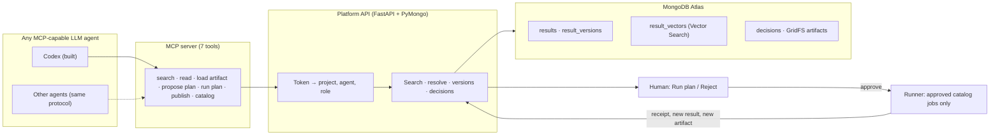

# Precedent architecture for hackathon judges

Precedent is a governed, shared memory for AI agents. An agent publishes what it learned from a piece of work: the conditions, the outcome and the artifacts it produced. A different agent, in a fresh session and with a differently worded goal, can find that evidence, decide whether it applies, and act on it. A person approves what actually runs. MongoDB Atlas holds the memory and enforces the rules.

Nothing in the platform is specific to one task or one agent. The demo is one instance of the pattern: Codex has a single four-epoch run to reach 80% accuracy on handwritten digits, and it reuses a stored checkpoint that another agent produced. The same contract serves any workflow where results, and the conditions behind them, are worth reusing.

## The layers

| Layer | Responsibility | Status |
| --- | --- | --- |
| Agent | Interprets evidence, chooses a job from the allowed catalog, explains why. It never holds Atlas credentials or tokens. | Codex is built and verified. Any MCP-capable agent can use the same endpoint, but only Codex has been run. |
| MCP server | The agent's only door. Seven tools: `experiment_profile`, `search_experiments`, `get_experiment`, `load_weights` (artifact metadata), `propose_plan`, `run_plan`, `publish_result`. | Served by the workbench at `/mcp` on loopback. A standalone, authenticated MCP server that any agent can reach is **planned**, not built. |
| Platform API | Maps an opaque bearer token to a trusted `project_id`, `agent_id` and `role` (reader, publisher, maintainer). Callers cannot supply their own identity. Fails closed on authorization, dependency or validation errors. | Built. |
| MongoDB Atlas | Authoritative state and the rules over it: isolation, versions, expiry, approval, artifacts, live change feed. | Built on the event Sandbox. |
| Human gate | A person confirms or rejects the stored plan. | Built. |
| Runner | Executes only an approved job from the catalog, after re-verifying the evidence it cites. | Built for the demo benchmark. |

Keeping the agent behind one MCP boundary is deliberate. Authorization, lifecycle and approval rules live in the platform and in MongoDB, so they hold no matter which agent connects or how it was prompted.

## Data model in Atlas

| Collection | Holds |
| --- | --- |
| `results` | The current record per result: project, author, version, conditions, outcome, inline evidence, `expires_at`, `purge_at`, and an event log. Execution status, scientific validity and result direction are stored separately, so a crash is never mistaken for a valid negative result. |
| `result_versions` | Superseded versions, keyed by result and version. Read only for history. |
| `result_vectors` | Immutable search entries: embedding, `project_id`, result id and version. A hit counts only if its version still matches the current head. |
| `decisions` | One plan per document with status `pending`, `approved`, `rejected`, `executed` or `aborted`, the cited result versions, the set-aside results and the runner's receipt. |
| GridFS | Artifacts such as model checkpoints, with a SHA-256 fingerprint checked before use. |

## Follow one handoff

1. **Publish.** An agent publishes a result with its conditions, outcome and evidence. The platform sets project and author from the token, writes the vector entry, then commits the record. Failed and crashed runs are stored too, tagged so they carry the right meaning.
2. **Retrieve.** The agent asks in its own words. The platform embeds the question and runs **one Atlas aggregation** on `result_vectors`:
   1. `$vectorSearch` with a filter on `project_id`, which isolates projects.
   2. `$lookup` to the live record, keeping a hit only if its version matches, `expires_at` is later than `$$NOW`, and the run completed with a valid result.
   3. `$unwind`, which drops stale, expired and crashed hits.
   4. `$addFields` computes an applicability label by comparing the task's conditions with each result's, such as dataset, model and input size.

   Retrieval policy lives in the database query, not in Python post-processing. A result from different conditions can be found and still labelled as not applicable, so the agent and the screen can show why it was set aside.
3. **Propose.** The agent calls `propose_plan` with a job from the catalog, the exact result versions it used, the results it set aside, and its reasoning. The decision is stored as `pending`. The platform rejects a plan whose job is not in the catalog or whose cited results are no longer current.
4. **Approve once.** The person chooses **Run plan** or **Reject**. Approval is a conditional update on `status`, so a plan cannot be approved twice, executed without approval, or run again.
5. **Run and verify.** The runner resolves the cited versions again immediately before acting. It streams the cited artifact from GridFS, checks its SHA-256, runs the job, and posts a receipt. If the evidence changed in between, the decision becomes `aborted` and nothing runs.
6. **Write back.** The measured outcome and the new artifact are published as a new result, so the next agent can build on them. Change streams push each publish, approval and receipt to the workbench without polling.

## Governance in the database

- **Access.** Every read and write is scoped by the project in the caller's token. A second project searching the same index gets nothing back, and the same query still returns the first project's own result.
- **Expiry.** `expires_at` is checked at query time, so an expired result disappears from every agent path immediately. A TTL index removes the data later and is only cleanup.
- **Correction.** A correction copies the current record into `result_versions` and replaces the head in one transaction, conditional on the expected version. Agents see only the new version. People can still read the history.
- **Evidence handling.** Retrieved memories and imported notes are treated as evidence. Access and lifecycle are enforced in code from the trusted caller identity.

Correction, expiry and history are in the backend. Their controls on the workbench screen are the next phase.

## What the Atlas activity strip shows

The workbench registers a PyMongo command listener and shows each real command: name, collection, duration and a redacted shape, with the query vector shown as `[1536 floats]` and no tokens or connection strings. Change-stream events appear next to them. The strip reports actual database activity and is not simulated.

## What to look for in the demo

- **The choice.** The agent finds a checkpoint that worked under matching conditions and proposes reusing it. The plan lists the evidence it used and the results it set aside.
- **The approval.** The plan is visible before anything runs, and the Atlas strip shows the conditional update behind the approval.
- **The measured outcome.** In one recorded comparison on the same held-out images, both with four epochs, training from scratch reached **29.2%** and reusing the stored checkpoint reached **90.4%**. The reuse job froze the pretrained backbone and trained the classifier head.
- **The next handoff.** The new result appears in the workbench and becomes searchable within the project.

## Built at the event, and credited

The platform, the MCP tools, the workbench, the benchmark runner and the seeded experiments were built for this event. ARA and AutoSci inspired the ideas of keeping dead ends as first-class results and revisiting failures only when conditions change. No ARA or AutoSci code, data or adapters are used. See [NOTICE.md](NOTICE.md) for upstream credits and licenses.

[Demo verification checklist](HUMANS.md) · [Run the workbench](BACKEND.md#live-workspace) · [Platform details](PLATFORM.md)
