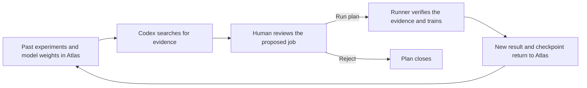

# Precedent architecture for hackathon judges

Precedent lets a fresh research agent build on experiments other agents have already run. In the demo, Codex has one four-epoch run to reach 80% accuracy on handwritten digits. It can search past experiments, propose a training job, and run it with human approval.

## Follow one experiment

1. **Save what happened.** MongoDB Atlas stores the setup, outcome, and evidence for each past experiment. GridFS, MongoDB’s file storage, keeps the model checkpoints. A checkpoint is a file containing the weights learned by a model. The record distinguishes a measured failure, such as an experiment that completed and missed its target, from a crash that produced no usable result.
2. **Find evidence that fits.** Codex uses research tools in the workbench to search Atlas by meaning. In one database query, Atlas limits results to the agent’s project, checks that each version is current and unexpired, and labels whether the experiment matches the task. A run on a different image size can be relevant enough to find while still being unsuitable as evidence for this job.
3. **Approve one job.** Codex proposes a job from the allowed catalog and cites the exact experiment versions it used. The workbench shows the plan and its reasoning. The operator chooses **Run plan** or **Reject**. Conditional database updates enforce approval and prevent duplicate execution claims.
4. **Train and save the result.** The runner checks the cited versions again, loads the exact checkpoint from GridFS, and verifies its file fingerprint before starting training. It evaluates on held-out images and saves the score and new checkpoint as another experiment. MongoDB change streams notify the workbench when records change.

## What to look for in the demo

- **The choice.** Codex finds a checkpoint that worked under matching conditions and proposes reusing it. The plan shows which evidence it used and which results it set aside.
- **The approval.** The workbench shows the plan before training. Its Atlas activity strip shows the database operation behind the approval.
- **The measured outcome.** In one recorded comparison, training from scratch reached **29.2%** and reusing the stored checkpoint reached **90.4%** on the same held-out images. Both runs used four epochs. The reuse job froze the pretrained backbone and trained the classifier head.
- **The next handoff.** The new experiment appears in the workbench and becomes available for future searches within the project.

The backend also supports correction, expiry, and version history. The main demo focuses on the path from saved evidence to an approved run and a new result.

[Demo verification checklist](HUMANS.md) · [Run the workbench](BACKEND.md#live-workspace) · [Platform details](PLATFORM.md)
