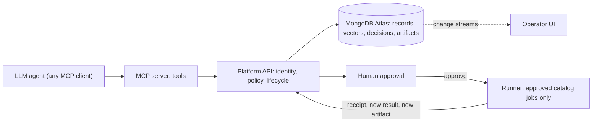

# Precedent architecture

Precedent is a governed, shared memory for AI agents. An agent publishes what it learned from a piece of work: the conditions, the outcome, the evidence and any artifacts it produced. A different agent, in a fresh session and with a differently worded goal, can find that evidence, decide whether it applies, and act on it. A person approves what actually runs. MongoDB Atlas holds the memory and enforces the rules.

The architecture is task-agnostic and agent-agnostic. Any MCP-capable LLM agent can use it, and any workflow whose results and conditions are worth reusing can be described to it through a job catalog. The demo is one instance of the pattern.

## Layers

| Layer | Responsibility |
| --- | --- |
| Agent | Any LLM agent that speaks MCP. It interprets evidence, chooses a job from an allowed catalog and explains why. It never holds database credentials or tokens. |
| MCP server | The agent's only entry point. Tools for browsing the job catalog, searching memory, reading a result and its evidence, loading an artifact, proposing a plan, running an approved plan and publishing a result. Today it is served beside the operator UI on loopback. A standalone, authenticated MCP server that any agent can connect to is planned and not built yet. |
| Platform API | Maps an opaque token to a trusted project, agent and role (reader, publisher, maintainer). Callers cannot supply their own identity. Enforces authorization, validation and lifecycle rules, and fails closed. |
| Memory store (MongoDB Atlas) | Authoritative state and the rules over it: project isolation, versions, expiry, approval state, artifacts and a live change feed. |
| Human gate | A person confirms or rejects a stored plan. Nothing runs without an approved decision. |
| Runner | Executes only an approved job from the catalog, after re-verifying the evidence the plan cites. |
| Operator UI | Shows evidence, plans and real database activity. It holds no tokens. |

Keeping the agent behind one boundary is deliberate. Authorization, lifecycle and approval rules live in the platform and in the database, so they hold no matter which agent connects or how it was prompted.

## Data model

| Store | Holds |
| --- | --- |
| Results | The current record for each finding: project, author, version, conditions, outcome, inline evidence and expiry. Execution status, scientific validity and result direction are separate fields, so a crash or inconclusive run is never mistaken for a valid negative result. |
| Versions | Superseded versions of a result, read only for history. |
| Vectors | Immutable search entries with an embedding, project and result version. A hit counts only if its version still matches the current record. |
| Decisions | One plan per document: status, the cited result versions, the set-aside results, the reasoning and the runner's receipt. |
| Artifacts | Files a result produced, stored with a content fingerprint that is checked before use. |

## One handoff

1. **Publish.** An agent publishes a result with its conditions, outcome and evidence. The platform sets project and author from the token and writes the vector entry before committing the record. Failed and crashed runs are stored too, tagged with their real meaning.
2. **Retrieve.** The agent asks in its own words. The platform embeds the question and runs one Atlas aggregation:
   1. `$vectorSearch` with a filter on the project, which isolates tenants.
   2. `$lookup` to the live record, keeping a hit only if its version matches, it has not expired, and the run completed with a valid result.
   3. `$unwind`, which drops stale, expired and crashed hits.
   4. `$addFields` computes an applicability label by comparing the task's conditions with each result's.

   Retrieval policy lives in the database query, not in application post-processing. A result from different conditions can be found and still be labelled not applicable, so the reason it was set aside is visible.
3. **Propose.** The agent submits a job from the catalog, the exact result versions it used, the results it set aside and its reasoning. The decision is stored as pending. A job outside the catalog, or a cited result that is no longer current, is rejected.
4. **Approve once.** A person approves or rejects. Approval is a conditional update on the decision's status, so a plan cannot be approved twice, run without approval or run again.
5. **Run and verify.** The runner resolves the cited versions again immediately before acting and checks any artifact's fingerprint. If the evidence changed in between, the decision is aborted and nothing runs. Otherwise the job runs and posts a receipt.
6. **Write back.** The measured outcome and any new artifact are published as a new result, so the next agent can build on them. Change streams push each publish, approval and receipt to the UI without polling.

## Governance in the database

- **Access.** Every read and write is scoped to the project in the caller's token. Another project searching the same index gets nothing back, while the owning project still finds its own results.
- **Expiry.** Expiry is checked at query time, so an expired result disappears from every agent path immediately. A TTL index removes the data later and is only cleanup.
- **Correction.** A correction moves the current record into version history and replaces it in one transaction, conditional on the expected version. Agents see only the new version. People can still read the old one.
- **Evidence handling.** Retrieved memories and imported notes are treated as evidence, not instructions. Access and lifecycle are enforced in code from the trusted caller identity.

Correction, expiry and history exist in the backend. Their controls in the operator UI are the next phase.

## Observability

The platform records each real database command (name, collection, duration and a redacted shape, with query vectors summarized and no tokens or connection strings) and relays it to the UI next to change-stream events. The activity shown is actual database activity, not simulated.

## Demo

The demo is one instance of this pattern. An agent finds a stored result that applies under matching conditions, proposes reusing it instead of recomputing, a person approves, and the new result is written back for the next agent. In one recorded comparison on the same task and budget, an agent with no memory reached **29.2%** and the same agent reusing a stored result reached **90.4%**.

## Built at the event, and credited

The platform, the MCP tools, the operator UI, the benchmark runner and the seeded experiments were built for this event. ARA and AutoSci inspired the ideas of keeping dead ends as first-class results and revisiting failures only when conditions change. No ARA or AutoSci code, data or adapters are used. See [NOTICE.md](NOTICE.md) for upstream credits and licenses.

[Demo verification checklist](HUMANS.md) · [Run the workbench](BACKEND.md#live-workspace) · [Platform details](PLATFORM.md)
