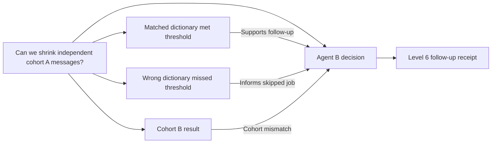

# Platform contract

Agent A publishes measured outcomes. A fresh Agent B uses event Atlas Vector Search to discover prior experiments, checks the conditions, and chooses a CPU job. Corrections and expiry change which evidence it can use. The same contract can support more agents and benchmarks through project membership, versioned results, and new job catalogs.

## Shared entry point

Use Python 3.11, FastAPI and PyMongo. P1 owns `uvicorn platform_api.app:app --host 127.0.0.1 --port 8000` and the HTTP JSON contract below. P2 and P3 can exercise their callers against a stub serving these payloads. P4 owns the top-level rehearsal. All commands in this plan are implementation targets.

The service maps opaque bearer tokens in server-side `MEMORY_TOKENS_JSON` to a trusted `project_id`, `agent_id`, and `role`. Example mapping entry: `{"<publisher-token>":{"project_id":"team-run-01","agent_id":"agent-a","role":"publisher"}}`. Issue a publisher token for A, a reader for B, a maintainer for corrections, and equivalent test identities in a second project for isolation. Rehearsals use fresh project IDs in the same Atlas database and index. The harness passes each process only its own token. Atlas and provider credentials stay with the service and trusted runner as applicable. Source metadata is attribution. The service sets project and author from the token and rejects caller-supplied identity fields. Readers can read and resolve usable project records. Publishers also publish and can correct or expire their own records. Maintainers can publish, correct, and expire within their project.

Every usable result has `schema_version: 1`, `hypothesis`, `fixture_revision`, flat `conditions` and `configuration` objects with scalar values, `metric` with name, value, unit, operator and threshold, `execution` (`completed|crashed|timed_out`), `validity` (`valid|invalid|inconclusive`), `direction` (`positive|negative|undetermined`), `evidence`, `source`, and UTC `expires_at`. A completed, valid measurement with a receipt supports a positive or negative direction according to the threshold. Other combinations require `undetermined` and may have a null metric value. The runner can show such records in a direct read while search and execution resolution use completed, valid results only.

Example body for `POST /v1/results`. Evidence is a small inline JSON receipt or curated source excerpt. The API serves it under the result's visibility and lifecycle.

```json
{
  "schema_version": 1,
  "hypothesis": "A shared phrase dictionary for cohort A will keep independent DEFLATE payloads at or below 40% of input bytes.",
  "fixture_revision": "short-events-v1",
  "conditions": {"cohort": "A", "split": "calibration", "codec": "zlib-wrapped-deflate", "dictionary_revision": "phrases-v1"},
  "configuration": {"job_id": "dict-a-l1", "level": 1, "dictionary_family": "A"},
  "metric": {"name": "wire_ratio", "value": 0.2607758621, "unit": "ratio", "operator": "<=", "threshold": 0.4},
  "execution": "completed",
  "validity": "valid",
  "direction": "positive",
  "evidence": {"kind": "job_receipt", "data": {"run_id": "cal-a-1", "input_bytes": 928, "output_bytes": 242, "roundtrip_ok": true}},
  "source": {"system": "autosci", "revision": "6bc834a805a1744959a9983809e5d6f0263ef791", "artifact": "wiki/experiments/dict-a-l1.md", "source_agent": "agent-a", "record": "dict-a-l1"},
  "expires_at": "2026-11-15T00:00:00Z"
}
```

Use a fresh future timestamp in the harness. In public output use only synthetic receipts and the attributed upstream examples below. `Ref` is `{"result_id":"<uuid>","version":1}`. `Result` is the publish body without `evidence`, plus `Ref` fields and `author_id`. Authorized project callers can read evidence through the evidence route. Output errors use `{"detail":"<stable code>"}`.

| Route | Request and success response |
| --- | --- |
| `POST /v1/results` | Publish body → 201 `Ref`. Version starts at 1. |
| `POST /v1/search` | `{"question":"How can we shrink each telemetry message sent on its own?"}` → 200 `{"candidates":[{"result":Result,"score":0.82}]}`. May return an empty list. |
| `GET /v1/results/{id}?version=1` | → 200 `Result`. An omitted version means current. |
| `GET /v1/results/{id}/evidence?version=1` | → 200 `{"result_id":"<uuid>","version":1,"evidence":{"kind":"job_receipt","data":{}}}`. Same optional-version behavior. |
| `POST /v1/results/{id}/correct` | `{"expected_version":1,"reason":"Receipt was linked to the wrong cohort","replacement":{...}}` with a full publish body → 200 `Ref` with version 2. |
| `POST /v1/results/{id}/expire` | `{"expected_version":2,"reason":"Withdraw observation"}` → 200 `{"result_id":"<uuid>","version":2,"expired":true}`. A scheduled expiry uses the publish timestamp. |
| `POST /v1/resolve` | `{"refs":[{"result_id":"<uuid>","version":1}]}` → 200 `{"results":[Result]}` in request order if every ref is current and usable. Validate immediately before dispatch. |

Use 401 for missing or unknown token, 403 for role denial on visible records, 404 for absent, out-of-scope, expired or historical reads and unusable resolve refs, 409 for a stale write on a visible current record, 422 for invalid bodies, and 503 for unavailable search. A resolve failure aborts dispatch and allows one fresh search and decision within the same job budget. Fail closed on authorization, dependency or validation errors. Token roles and source fields are kept distinct.

## Atlas storage and lifecycle

- `MEMORY_ATLAS_URI` and `MEMORY_ATLAS_DB` point to the event Sandbox. `results` holds the authoritative current document keyed by UUID. It has `project_id`, `author_id`, `version`, `search_key`, normalized fields, inline evidence, `expires_at`, `purge_at` and audit entries containing previous version, timestamp, reason and actor. Each correction atomically replaces the current payload and appends the supersession entry using a conditional update on project, current version and active expiry. Manual expiry atomically sets `expires_at` to service time and records why. The original publisher retains ownership.
- `result_vectors` holds immutable search entries keyed by a generated `search_key` with `project_id`, `result_id`, `version`, `embedding`, `embedding_model`, and `purge_at`. Stage the vector before committing the head for usable records. A candidate is accepted only if its key and version match the authoritative head. An orphan or old key is inert and eligible for cleanup. The `research_memory_v1` index has a 1536-dimensional cosine vector field `embedding` and a filter field `project_id`. Embed hypothesis, summarized measurement, fixture and conditions using `text-embedding-3-small` at 1536 dimensions. Embed the search question with the same model. Service secrets use `OPENAI_API_KEY`. [Embedding model](https://developers.openai.com/api/docs/models/text-embedding-3-small)
- Put `$vectorSearch` first with `exact: true`, `limit: 12`, and a `project_id` filter derived from the token. If the Sandbox rejects exact search, use ANN with `numCandidates: 240` and the same filter and limit. Project only candidate keys, versions, IDs and scores. Hydrate from the primary using the authorized project and service UTC clock. Drop stale, mismatched, invalid and expired hits before returning up to eight results. Recheck lifecycle at direct read, evidence read and execution resolution. Both projects get their own sentinel in the selectivity test. [Atlas Vector Search](https://www.mongodb.com/docs/vector-search/query/aggregation-stages/vector-search-stage/)
- Correction discards the old payload and its inline evidence from the head. Its audit metadata stays with the result. Expiry immediately hides the entire current record and evidence. TTL on each collection's BSON Date `purge_at` with `expireAfterSeconds: 0` is asynchronous cleanup. Current results and their vectors get `expires_at + 24h` at creation. After correction or manual expiry, best-effort deletion of the retired vector can shorten retention. Shorten the result purge date to the new expiry plus 24h on manual expiry. The API stays correct if deletion or TTL lags. [Atlas TTL](https://www.mongodb.com/docs/manual/core/index-ttl/)

## First benchmark and agent decision

Use `short-events-v1`, a synthetic independent-event compression fixture. A pre-shared dictionary models a receiver that already has the deployment's event vocabulary. Count all zlib stream bytes, including headers and the dictionary ID. Dictionary distribution is a fixed setup cost outside the per-message metric and should be disclosed in the demo.

Generate 32 ASCII tokens per cohort A and B using the first 24 hex characters of SHA-256 of `"{cohort}:{i}"` for indices 0–31. Join each cohort's 32 tokens with `|` for its pre-shared `phrases-v1` dictionary. Make eight rows per split, each the first 16 hex characters of SHA-256 of `"{cohort}:{split}:{j}"` followed by four tokens, all joined by `|`. Use token indices `(4*j + offset + k) % 32`, where `j=0..7`, `k=0..3`, and offset is 0 for `calibration` and 1 for `holdout`. Each split has 928 input bytes. Compress each row in its own `zlib.compressobj(level, zlib.DEFLATED, 15, **kwargs)` stream, with `zdict` only for dictionary jobs. Decompress with identical dictionary and window settings and verify exact equality and end-of-stream for all rows. Score `wire_ratio = sum(output_bytes) / sum(input_bytes)` with `<= 0.40` as success. Record fixture and dictionary hashes and the zlib version in the receipt.

| Producer run | Input | Configuration | Planning probe |
| --- | --- | --- | --- |
| Promising observation | A calibration | `dict-a-l1`, level 1, dictionary A | 242/928, positive |
| Prior unsuccessful path | A calibration | `dict-b-l1`, level 1, dictionary B | 760/928, completed valid negative with all rows decoded |
| Distractor | B calibration | `dict-b-l1`, level 1, dictionary B | 234/928, positive under cohort B |

Agent A runs these three fixed calibration jobs, exports their measured receipts, publishes by way of the two adapters, then exits. Use the ARA adapter for the valid negative and AutoSci for the promising observation and distractor. P2 also checks the real pinned upstream examples with a separate smoke project. The synthetic benchmark artifacts use fresh measurements in upstream-compatible shapes.

Each fresh Agent B process uses the same request, one job budget, prompt, and ordered catalog. Request: “Can we get individually transmitted cohort A telemetry well under half its original size on unseen events? Aim for 40% or less and spend one trial.” Search question: “What previously helped shrink one-at-a-time cohort A telemetry packets?” Published producer text uses independent DEFLATE event payloads and shared phrase dictionaries. Smoke-check the paraphrase in a set with five unrelated valid observations and the cohort B distractor. The required observations and distractor must be available among the authorized candidates, and at least one applicable observation must rank above all unrelated observations. Show a matched condition and a rejected cohort in the decision receipt.

| Mode | Expected actual job on A holdout | Planning probe |
| --- | --- | --- |
| Memory off | `plain-l1`, level 1, no dictionary | 686/928 |
| Memory on | `dict-a-l6`, level 6, dictionary A | 238/928 |
| After correction | `plain-l1` after correcting the promising record's cohort to B and replacing its evidence with the measured B calibration result for dictionary A | 686/928 |
| After scheduled expiry | `plain-l1` after the promising result's `expires_at` passes in an independent seeded scenario | 686/928 |

The third candidate, `dict-b-l6`, measured 760/928 on A holdout in the probe. Measure it during fixture validation so the receipt comparison can account for every candidate. Each accepted result should be on the expected side of the threshold. Byte counts can vary by zlib version, which the runner records.

The catalog order is `plain-l1`, `dict-a-l6`, `dict-b-l6`. A no-evidence baseline uses the dictionary-free validation trial because it assumes no usable receiver vocabulary. With evidence B chooses whether to extend a supported approach and records which approaches it skips and why. Fetch each candidate's versioned evidence before the decision and attach the measurement to the model context. Drop a candidate if its evidence has since become unavailable. Configure one stateless `gpt-4.1-mini-2025-04-14` Responses request per decision with a JSON schema for `job_id`, `used_refs`, `skipped_jobs` with reasons and refs, `rejected_candidates` with refs and applicability reasons, and `reason`. Instructions favor a bounded follow-up with applicable support, then the dictionary-free baseline. The applicability rule is exact agreement on fixture revision, cohort, codec and dictionary revision, with declared calibration-to-holdout transfer. Level 1 supports testing the same dictionary family at level 6. A valid negative discourages a repeat of that dictionary family in the same conditions and is advisory across compression levels. B evaluates applicability and chooses the job. Code validates the allowlist, budget and applicability of references used to justify the selection and skips. Resolve those exact references before executing. Keep rejected refs in the trace as candidates B considered. The runner applies only the registered config and does one round-trip-checked measurement. [Planner model](https://developers.openai.com/api/docs/models/gpt-4.1-mini)

P3 owns `python -m benchmark.run --job dict-a-l6 --cohort A --split holdout` and `python -m benchmark.agent --memory on --base-url http://127.0.0.1:8000 --out receipts/on.json`. `--memory off` bypasses retrieval and uses an empty candidate list. B reads its token from `MEMORY_TOKEN`. The output includes request, model, catalog and budget, selected and skipped jobs, candidate/result refs and applicability reasons, exact used refs, executed configuration, runtime, status, metric, input and output byte counts, hashes and round-trip evidence. The planning arithmetic above came from a local Python 3.11 standard-library probe. Build acceptance requires receipts from the new runner. For the correction, separately measure `dict-a-l1` on B calibration (probe 760/928), yielding a valid negative under B. Credit that receipt as the replacement and retain the version link.

## Research tree

Use a read-only browser view at `/research` for researchers reviewing agent work. The first screen opens the benchmark question and its branches. A search box uses the existing scoped semantic search to find other researchers’ results in the current project. Selecting a hit opens its branch when present or its evidence inspector when the result has no local lineage. Researchers can browse by question and compare measurements across agents in the same project.

| View | Interaction |
| --- | --- |
| Research tree | Expand a question into measured observations and agent decisions. Show the two cohort A results and the cohort B distractor. Under the decision, show the follow-up run and explain which candidate was skipped and which observation was ruled out by its conditions. |
| Evidence inspector | Select a node to see the author and source artifact, execution status, scientific validity, outcome, conditions, configuration, metric and threshold, and the measured receipt. Select the agent decision to see its exact cited result versions, rationale, and the job that actually ran. |
| Compare runs | Switch among off, on, and corrected rehearsal receipts for the same question. Show executed job and byte ratio together. Label unavailable evidence on historical receipts and keep exact-version references. |

The layout uses an expandable semantic tree and a details pane. On narrow screens show details below the selected branch. Support keyboard navigation, visible focus, clear loading, empty and unavailable states, and text labels for outcome and validity. A completed valid negative and an execution failure use distinct labels. Show conditions before interpreting an outcome.



P4 owns the browser page and the tree manifest emitted by the harness. Serve a simple static HTML, CSS and JavaScript bundle from the API origin so the UI can use its existing routes. The manifest holds `question`, decision and run IDs, and observation references as `{result_id, version}`. Each decision receipt already carries `used_refs`, `skipped_jobs`, `rejected_candidates`, and the executed run. Use those links to render lineage. Group branches from the manifest and hydrate observation details and evidence through the platform API. The first view can start against stubbed HTTP responses and the harness receipt shape. P1 provides a same-origin mount point and a restricted project reader token for the local demo. Keep the token in memory for the session. Ship a labeled synthetic manifest for preview and load demo receipts from the local harness. Keep private receipts, result text, and tokens out of static files.

Render referenced observations only after a versioned authorized read. Cross-project, expired, and superseded observations get a generic “Evidence unavailable” state wherever a receipt already references a ref. Clear previously loaded details on a failed recheck or identity change. Inspecting a receipt rechecks its references, and opening evidence uses the exact cited version. Historical execution receipts retain the executed job and metric. Keep full local demo receipts in the authorized rehearsal context, and use only synthetic redacted material for public replay.

For research at scale, render the visible question as a tree backed by a graph. Keep a shared observation once and render cross-links from every decision that cites it. Future expansion uses paginated neighbors, semantic entry points, and filters for project, cohort, source and validity. A result from another researcher is discoverable through authorized project membership. The first demo needs one question, branching and an evidence inspector with existing search. The governed execution path and comparison receipts remain the submission centerpiece.

## ARA and AutoSci adapters

Both adapters transform a single artifact record plus a JSON sidecar for explicit metric, settings and evidence into the publish body. Use `python -m adapters.ara --input PATH --node ID --context PATH [--publish]` and `python -m adapters.autosci --input PATH --context PATH [--publish]`. Default prints normalized JSON. `--publish` posts to the shared API using `MEMORY_BASE_URL` and `MEMORY_TOKEN` and prints the returned ref. Sidecar keys are `fixture_revision`, `conditions`, `configuration`, `metric`, `evidence`, `expires_at`, and `source` with `revision`, `artifact`, `source_agent` and `record`. The adapter sets `source.system` and validates record-to-sidecar and evidence agreement. Missing or contradictory data fails normalization. Source paths are attribution and evidence data is explicitly supplied. Agent A generates the benchmark artifacts and sidecars from runner receipts. Use PyYAML safe loading, a narrow shape validator and scoped fixture paths. Budget 45 minutes per adapter and 25 minutes to integrate both.

- **ARA.** Read the pinned companion's `artifacts/rebench/rebench-triton_cumsum/trace/exploration_tree.yaml` by recursive node ID. Node N122 is a completed, numerically correct advanced-indexing/scatter-gather experiment whose score 1.3605 missed the 0.47 target. Its evidence is `evidence/tables/malt_attempts.md`, MALT run 343935 attempt 20. Preserve method, approach context, node, source agent, table row, GPU workload conditions and score. Where N122 omits a dedicated hypothesis, the sidecar supplies the explicit goal derived from its context and evidence. Check N120 against attempt 16 in the same table as `crashed/invalid/undetermined`, preserving the exec-loaded Triton JIT error and null score. Never infer direction from `type: dead_end`. Benchmark export uses the same node fields plus explicit hypothesis and evidence. This needs one YAML reader and a curated sidecar, with the upstream CLI and runtime off the build path. [ARA layout](https://github.com/ARA-Labs/Agent-Native-Research-Artifact/tree/e52a925e9d03b4ada3008653e72f99b04116fca2) · [Pinned trace and evidence](https://github.com/AmberLJC/ara-paperbench/tree/3fe7ab4d08f68555d8c4661fa2b4fbfd4d597fd8/artifacts/rebench/rebench-triton_cumsum)
- **AutoSci.** Read the SciMem experiment page `wiki/experiments/{slug}.md` after `/exp-run {slug} --collect` fills in results and `/exp-eval` writes `## Idea updates`. Parse YAML frontmatter (`slug`, `status`, `outcome`, `hypothesis`, `linked_idea`, `setup`, `metrics`, `key_result`) and preserve `Setup`, `Results`, and the `Verdict` line as evidence context. In the pinned schema, `metrics` is a list of names. The fixture puts `wire_ratio` in that list, measured bytes in `Results`, and a receipt in the sidecar with numerical metric and threshold. Use the receipt for validity and direction. Completed succeeded/failed records need matching measurements and conclusive evidence. Inconclusive results are undetermined. Reject unfinished pages at this handoff. The `exp-eval` verdict concerns the linked idea and stays source metadata in the evidence. The benchmark fixture is event-authored and matches the pinned schema and template. Native execution would add Claude Code, the wiki runtime and review tooling. The adapter starts at the persisted handoff and needs the same YAML library as ARA. [SciMem](https://arxiv.org/html/2605.31468v1#S3) · [Collection](https://github.com/PKU-DAIR/AutoSci/blob/6bc834a805a1744959a9983809e5d6f0263ef791/i18n/en/skills/exp-run/SKILL.md) · [Evaluation](https://github.com/PKU-DAIR/AutoSci/blob/6bc834a805a1744959a9983809e5d6f0263ef791/i18n/en/skills/exp-eval/SKILL.md) · [Schema](https://github.com/PKU-DAIR/AutoSci/blob/6bc834a805a1744959a9983809e5d6f0263ef791/runtime/schema/entities.yaml) · [Template](https://github.com/PKU-DAIR/AutoSci/blob/6bc834a805a1744959a9983809e5d6f0263ef791/runtime/templates/experiments.md.tmpl)

P2 records provenance in the event repo. Credit ARA at `e52a925e9d03b4ada3008653e72f99b04116fca2` (MIT, Orchestra Research), the companion at `3fe7ab4d08f68555d8c4661fa2b4fbfd4d597fd8` (CC BY 4.0, Amber Liu and ARA project contributors), and AutoSci at `6bc834a805a1744959a9983809e5d6f0263ef791` (MIT, OmegaWiki Contributors). Link source and license, mark adapted excerpts, and include full MIT notices if distributing copies or substantial portions. Credit upstream schemas and examples and identify platform, adapters, benchmark and harness as event-built. Fetch pinned references for the upstream check and ship the synthetic fixtures with the demo. [ARA license](https://github.com/ARA-Labs/Agent-Native-Research-Artifact/blob/e52a925e9d03b4ada3008653e72f99b04116fca2/LICENSE) · [Companion license](https://github.com/AmberLJC/ara-paperbench/blob/3fe7ab4d08f68555d8c4661fa2b4fbfd4d597fd8/LICENSE) · [AutoSci license](https://github.com/PKU-DAIR/AutoSci/blob/6bc834a805a1744959a9983809e5d6f0263ef791/LICENSE)
